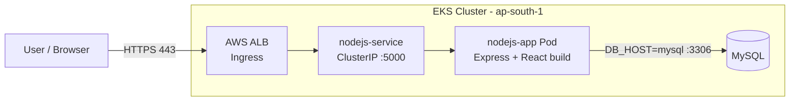
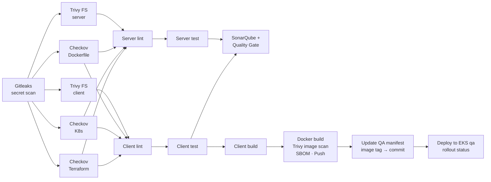

# 3-Tier User Platform

A full-stack **user management application** (React + Node.js/Express + MySQL), containerised with Docker and shipped to **AWS EKS** through a **DevSecOps CI/CD pipeline** on GitHub Actions, with separate **QA** and **Production** environments.


---

## Table of Contents

- [Architecture](#architecture)
- [Tech Stack](#tech-stack)
- [Project Structure](#project-structure)
- [API Reference](#api-reference)
- [Running Locally](#running-locally)
- [Running with Docker](#running-with-docker)
- [Deploying to Kubernetes (EKS)](#deploying-to-kubernetes-eks)
- [CI/CD Pipelines](#cicd-pipelines)
- [Required Secrets & Variables](#required-secrets--variables)
- [Environment Variables](#environment-variables)
- [Roadmap / Known Limitations](#roadmap--known-limitations)

---

## Architecture

| Tier | Component | Responsibility |
|------|-----------|----------------|
| **Presentation** | React 17 SPA (Webpack bundle) | Form to add users and list existing users |
| **Application** | Node.js / Express (port `5000`) | REST API under `/api/users`, also serves the built frontend |
| **Data** | MySQL | Stores the `users` table (auto-created on startup) |

The frontend and backend ship as **one container image**: Webpack builds the React app into static files, and Express serves them alongside the API.



---

## Tech Stack

| Area | Tools |
|------|-------|
| Frontend | React 17, Webpack 5, Babel |
| Backend | Node.js 20, Express 4, `mysql` driver, CORS |
| Database | MySQL |
| Containerisation | Docker (`node:20-alpine`, non-root user) |
| Orchestration | Kubernetes on AWS EKS, AWS Load Balancer Controller (ALB Ingress), ACM TLS |
| CI/CD | GitHub Actions, GitOps-style manifest updates |
| Security scanning | Gitleaks, Checkov, Trivy (filesystem + image), Syft SBOM (SPDX), SonarQube |
| Cloud auth | GitHub OIDC → AWS IAM role (no long-lived AWS keys) |

---

## Project Structure

```
.
├── client/                     # React frontend
│   ├── public/                 # index.html, styles, built bundle.js
│   ├── src/
│   │   ├── App.js              # Main UI (add + list users)
│   │   ├── api/users.js        # Axios API helpers
│   │   └── components/         # UsersList, UserItem
│   ├── webpack.config.js
│   └── package.json
├── server/                     # Express backend
│   ├── server.js               # Entry point: API routes, DB init, static hosting
│   ├── config/db.js            # MySQL connection (modular version)
│   ├── models/ controllers/ routes/
│   └── package.json
├── k8-manifests/
│   ├── qa/                     # Deployment, Service, Ingress for QA namespace
│   └── prod/                   # Deployment, Service, Ingress for prod namespace
├── .github/workflows/
│   ├── qa-cicd.yml             # Full DevSecOps CI/CD → QA
│   └── prod-cd.yaml            # Promote image → Production
├── Dockerfile
├── .dockerignore
└── sonar-project.properties
```

---

## API Reference

Base path: `/api`

| Method | Endpoint | Body | Description |
|--------|----------|------|-------------|
| `GET` | `/api/users` | – | List all users |
| `POST` | `/api/users` | `{ "name", "email", "role" }` | Create a user (`role` is `Admin` or `User`) |
| `PUT` | `/api/users/:id` | `{ "name", "email", "role" }` | Update a user |
| `DELETE` | `/api/users/:id` | – | Delete a user |

Any other route returns the React app (`index.html`).

**Example**

```bash
curl -X POST http://localhost:5000/api/users \
  -H "Content-Type: application/json" \
  -d '{"name":"Jane Doe","email":"jane@example.com","role":"Admin"}'
```

**Database schema** (created automatically on server start):

```sql
CREATE TABLE IF NOT EXISTS users (
  id    INT AUTO_INCREMENT PRIMARY KEY,
  name  VARCHAR(255) NOT NULL,
  email VARCHAR(255) NOT NULL UNIQUE,
  role  ENUM('Admin', 'User') NOT NULL
);
```

---

## Running Locally

**Prerequisites:** Node.js 20+, npm, and a running MySQL instance.

1. **Create the database and user**

   ```sql
   CREATE DATABASE test_db;
   CREATE USER 'appuser'@'%' IDENTIFIED BY '<your-password>';
   GRANT ALL PRIVILEGES ON test_db.* TO 'appuser'@'%';
   FLUSH PRIVILEGES;
   ```

2. **Build the frontend**

   ```bash
   cd client
   npm install
   npm run build        # outputs client/public/bundle.js
   ```

3. **Start the backend**

   ```bash
   cd ../server
   npm install
   DB_HOST=localhost DB_USER=appuser DB_PASSWORD=<your-password> DB_NAME=test_db npm start
   ```

4. Open **http://localhost:5000**

---

## Running with Docker

```bash
# Build the image
docker build -t <dockerhub-user>/nodejs-app:local .

# Create a network and start MySQL
docker network create app-net
docker run -d --name mysql --network app-net \
  -e MYSQL_ROOT_PASSWORD=<root-password> \
  -e MYSQL_DATABASE=test_db \
  -e MYSQL_USER=appuser \
  -e MYSQL_PASSWORD=<your-password> \
  mysql:8

# Start the app
docker run -d --name app --network app-net -p 5000:5000 \
  -e DB_HOST=mysql -e DB_USER=appuser \
  -e DB_PASSWORD=<your-password> -e DB_NAME=test_db \
  <dockerhub-user>/nodejs-app:local
```

> The app exits if it can't reach MySQL. If it starts before MySQL is ready, just run `docker start app` again.

---

## Deploying to Kubernetes (EKS)

The manifests in `k8-manifests/` cover the **app tier only**. Create these in each namespace (`qa`, `prod`) first:

1. **Namespaces**
   ```bash
   kubectl create namespace qa
   kubectl create namespace prod
   ```

2. **MySQL** – a Deployment/StatefulSet exposed by a Service named **`mysql`** on port `3306` (the app uses `DB_HOST=mysql`).

3. **Database secret** – `mysql-secret`:
   ```bash
   kubectl create secret generic mysql-secret -n qa \
     --from-literal=MYSQL_DATABASE=test_db \
     --from-literal=MYSQL_USER=appuser \
     --from-literal=MYSQL_PASSWORD=<your-password> \
     --from-literal=DATABASE_URL=mysql://appuser:<your-password>@mysql:3306/test_db
   ```

4. **Image pull secret** – `regcred`:
   ```bash
   kubectl create secret docker-registry regcred -n qa \
     --docker-username=<dockerhub-user> \
     --docker-password=<dockerhub-token>
   ```

5. **AWS Load Balancer Controller** installed in the cluster, plus an **ACM certificate** for your domain (update `certificate-arn` and `host` in `app-ingress.yaml`).

6. **Apply the manifests**
   ```bash
   kubectl apply -f k8-manifests/qa/ -n qa
   kubectl rollout status deployment/nodejs-app -n qa
   kubectl get ingress -n qa      # ALB DNS name → point your domain here
   ```

Repeat steps 3–6 with `-n prod` and `k8-manifests/prod/` for production.

---

## CI/CD Pipelines

### Branching model

| Branch | Pipeline | Target |
|--------|----------|--------|
| `qa` | `qa-cicd.yml` – build, scan, push, deploy | EKS namespace `qa` |
| `main` | `prod-cd.yaml` – promote tested image, deploy | EKS namespace `prod` |

### QA pipeline – `qa-cicd.yml`

Triggered on push to `qa` when `client/`, `server/` or the workflow file changes.



Every scan uploads its report (JSON/table/SPDX) as a workflow artifact.

### Production pipeline – `prod-cd.yaml`

Triggered on push to `main` when `k8-manifests/prod/app-deployment.yaml` or the workflow changes (e.g. when `qa` is merged into `main`).

1. **Promote** – pull the QA image, retag as `prod-<commit-sha>`, push.
2. **Update manifest** – rewrite the image tag in `k8-manifests/prod/app-deployment.yaml` and commit with `[skip ci]`.
3. **Deploy** – assume the AWS role via OIDC, `kubectl apply` to namespace `prod`, wait for rollout.

---

## Required Secrets & Variables

Set these under **Settings → Secrets and variables → Actions**.

| Name | Type | Used by | Purpose |
|------|------|---------|---------|
| `DOCKERHUB_USERNAME` | Variable | QA, Prod | Docker Hub login |
| `DOCKERHUB_TOKEN` | Secret | QA, Prod | Docker Hub access token |
| `SONAR_TOKEN` | Secret | QA | SonarQube authentication |
| `SONAR_HOST_URL` | Secret | QA | SonarQube server URL |
| `AWS_ROLE_TO_ASSUME` | Secret | QA | IAM role ARN for the QA deploy (OIDC) |
| `AWS_ROLE_TO_ASSUME1` | Secret | Prod | IAM role ARN for the prod deploy (OIDC) |

The IAM roles need a trust policy for GitHub's OIDC provider (`token.actions.githubusercontent.com`) scoped to this repository, plus EKS access to the target namespace.

---

## Environment Variables

| Variable | Default (dev only) | Description |
|----------|--------------------|-------------|
| `PORT` | `5000` | HTTP port |
| `DB_HOST` | `localhost` | MySQL host |
| `DB_USER` | `appuser` | MySQL user |
| `DB_PASSWORD` | – | MySQL password (always set this explicitly) |
| `DB_NAME` | `test_db` | Database name |

---

## Roadmap / Known Limitations

- [ ] Wire up the **Edit** and **Delete** buttons in the UI (the API already supports them)
- [ ] Add MySQL manifests (StatefulSet + PVC) to `k8-manifests/`
- [ ] Add liveness/readiness probes, resource requests/limits and `securityContext` to the Deployment
- [ ] Add real `lint` and `test` scripts so those pipeline stages enforce something
- [ ] Make security scans and the SonarQube quality gate fail the build on HIGH/CRITICAL findings
- [ ] Promote the exact tested commit SHA to prod instead of `:latest`
- [ ] Remove unused backend modules (`app.js`, `config/`, `models/`, `controllers/`, `routes/`) or switch `server.js` to use them

---

## License

Add a license of your choice (e.g. MIT) in a `LICENSE` file.
